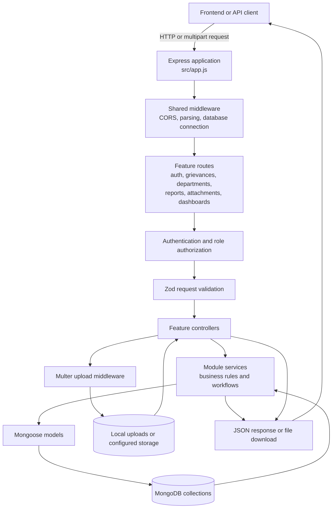
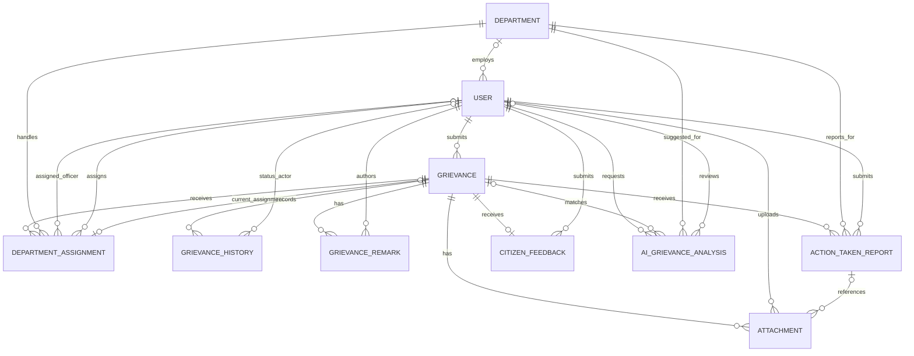

# Public Grievance Redressal Portal — Backend

## Project overview

The backend provides the API and data services for the CM Kerala Public Grievance Redressal Portal. It supports citizen submissions and tracking, CMO review and department assignment, officer action reports, grievance history and remarks, attachments, citizen feedback, contact enquiries, and role-specific dashboards.

## Features

- Citizen registration and authentication, with role-specific access for citizens, CMO administrators, and department officers.
- Grievance submission, reference-number tracking, status history, filtering, prioritization, assignment, escalation, and resolution.
- Department and officer administration, including assignment of officers to departments.
- Department action-taken reports with optional supporting attachments.
- Public and internal CMO remarks, and post-resolution citizen feedback.
- Gemini-powered grievance summaries and advisory recommendations, including possible duplicate candidates.
- Contact enquiry management and CMO/department dashboards.
- Request validation, role-based authorization, readiness checks, and consistent JSON error responses.
- File uploads for JPEG, PNG, WebP, PDF, and Word documents, up to 10 MB per file and five files per upload.

## Tech stack

- **Runtime:** Node.js with native ES modules
- **HTTP framework:** Express 5
- **Database and ODM:** MongoDB and Mongoose 8
- **Validation:** Zod
- **Authentication:** JSON Web Tokens in role-specific HttpOnly cookies
- **Password hashing:** bcrypt
- **Uploads:** Multer

## Backend architecture

The backend is organized around Express routes and feature modules. Requests pass through shared middleware for CORS, parsing, database availability, authentication, role authorization, and Zod validation before reaching a controller. Controllers coordinate module services and Mongoose models. Grievance data and related records are stored in MongoDB; uploaded files are stored on disk according to the configured upload directory.



Health checks are mounted separately so liveness can be checked without a database connection. Database-backed `/api` requests connect to MongoDB before route handling. Authentication uses signed tokens in role-specific HttpOnly cookies; authorization is enforced in the backend for each protected operation.

## Database collections and relationships

The backend uses MongoDB with Mongoose. Model references are stored as ObjectIds and are populated by the application when needed; they are not relational foreign keys, and MongoDB does not automatically enforce that referenced documents exist. The `auth.model.js` module re-exports `User` and does not create its own collection.

| Model | MongoDB collection | Relationship summary |
|---|---|---|
| `User` | `users` | May reference a `Department`; citizens submit grievances; CMO users assign grievances and create remarks; officers submit action reports. |
| `Department` | `departments` | Has officers through `User.department`; handles grievance assignments and is referenced by action reports. |
| `Grievance` | `grievances` | References its citizen and current assignment; has history, assignments, remarks, action reports, attachments, and optional citizen feedback. |
| `DepartmentAssignment` | `departmentassignments` | References one grievance, one department, and optional officer and assigning user. A grievance's `assignment` points to the current assignment; earlier assignment records preserve assignment history. |
| `GrievanceHistory` | `grievancehistories` | References a grievance and optional user associated with the status change. |
| `GrievanceRemark` | `grievanceremarks` | References a grievance and the user who created the remark; visibility is public or internal. |
| `ActionTakenReport` | `actiontakenreports` | References a grievance, department, submitting user, and zero or more attachment records. |
| `Attachment` | `attachments` | References its grievance and uploader; action reports also reference their associated attachments. File contents are stored outside MongoDB, while this collection stores file metadata. |
| `CitizenFeedback` | `citizenfeedbacks` | References a grievance and citizen; the unique grievance reference allows at most one feedback record per grievance. |
| `AIGrievanceAnalysis` | `aigrievanceanalyses` | References the requesting user and suggested department; can optionally reference a grievance and reviewer. Stores generated analysis, a hash of the input description, duplicate candidates, and review state. |
| `ContactEnquiry` | `contactenquiries` | Standalone public enquiry record; it has no references to other collections. |

### Entity-relationship diagram



`||` denotes exactly one, `o|` zero or one, and `o{` zero or many. `CONTACT_ENQUIRY` is intentionally omitted from the relationship diagram because it is standalone. For field definitions, enum values, validation rules, and indexes, see [Database Design](../documentation/03_Database_Design.md).

## Run locally

### Prerequisites

- Node.js and npm.
- MongoDB running locally or a MongoDB URI reachable from your machine.

### Install dependencies

From the repository root, open a terminal and run:

```powershell
cd backend
npm ci
```

### Configure environment variables

Create `backend/.env` from the example file:

```powershell
Copy-Item .env.example .env
```

Edit `.env` and set at least `MONGODB_URI` and a private `JWT_SECRET` of 32 or more characters. Configure the CMO administrator values before running the seed command.

| Variable | Required | Description |
|---|---|---|
| `NODE_ENV` | No | Runtime mode; defaults to `development`. Use `production` for deployment. |
| `PORT` | No | HTTP port; defaults to `8080`. Must be an integer from 1 to 65535. |
| `MONGODB_URI` | Yes | MongoDB connection string, for example `mongodb://127.0.0.1:27017/grievance_portal`. |
| `JWT_SECRET` | Yes | Private token-signing secret, minimum 32 characters. Use a securely generated value; never commit it. |
| `JWT_EXPIRES_IN` | No | Access-token expiry accepted by jsonwebtoken; defaults to `1d`. |
| `CLIENT_ORIGIN` | No | Frontend origin included in `.env.example`. The current `src/app.js` CORS configuration uses a fixed allowlist instead of this setting; see the CORS note below. |
| `COOKIE_SAME_SITE` | No | Cookie policy: `strict`, `lax`, or `none`. Defaults to `lax` in development and `none` in production. |
| `COOKIE_SECURE` | No | Set to `true` to mark cookies Secure. Automatically enabled in production. Required when `COOKIE_SAME_SITE=none`. |
| `CMO_ADMIN_NAME` | For seeding | Name for the initial CMO administrator; defaults to `CMO Administrator`. |
| `CMO_ADMIN_EMAIL` | For seeding | Email for the initial CMO administrator. |
| `CMO_ADMIN_PASSWORD` | For seeding | Initial CMO password; required for seeding and must be at least 12 characters. |
| `UPLOAD_DIRECTORY` | No | Optional override for the directory used to store uploads. Must point to writable storage; local default is `backend/uploads/`. |
| `GOOGLE_GEMINI_API_KEY` | For AI analysis | Google Gemini API key. AI analysis returns HTTP 503 when it is not configured. |
| `GEMINI_MODEL` | No | Gemini model name; defaults to `gemini-2.0-flash`. |

The checked-in `.env.example` contains development defaults and placeholders. Replace the JWT and administrator password placeholders with private values before use. Do not commit `.env` or production credentials.

### Seed the first CMO administrator

With MongoDB running and `CMO_ADMIN_EMAIL` and `CMO_ADMIN_PASSWORD` configured, run this once:

```powershell
npm run seed
```

The seed script creates the initial CMO account and sample departments. It does not reset an existing CMO account's password. Public registration creates citizen accounts only; additional department officers are created by a CMO administrator.

### Start the API

From `backend/`, run:

```powershell
npm run dev
```

The server connects to MongoDB and listens on `http://localhost:8080` by default. Check:

- Liveness: `http://localhost:8080/health/live`
- Database readiness: `http://localhost:8080/api/health/ready`

Use `npm start` to run the server without the development watcher.

## Tests

Run the backend's Node.js test suite from `backend/`:

```powershell
npm test
```

## API documentation

For the complete endpoint reference, including methods, access roles, parameters, and request/response examples, see the [API Documentation](../documentation/04_API_Documentation.md).

For AI provider configuration and the citizen-to-CMO analysis workflow, see [AI Integration](../documentation/05_AI_Integration.md).

## Authentication and CORS

The API uses separate HttpOnly cookies for citizen, CMO, and department-officer sessions. Authenticated browser requests should include credentials and the `X-Portal-Role` header so the API selects the correct cookie. Production deployments on separate frontend/backend origins generally require HTTPS and `COOKIE_SAME_SITE=none` with `COOKIE_SECURE=true`; browser cookie restrictions also apply.

**CORS configuration note:** `CLIENT_ORIGIN` is loaded by the backend configuration, but the current Express CORS middleware in `src/app.js` defines a hard-coded origin allowlist. If the frontend uses a different origin, update that allowlist in `src/app.js` and ensure credentialed requests are enabled. Setting `CLIENT_ORIGIN` alone does not currently change the allowlist.

## Existing database migration

If upgrading a database with legacy embedded grievance relations to the split collections used by the current models, back up the database first, then run the migration once:

```powershell
npm run migrate:grievance-relations
```

Do not run this migration against an existing production database without a verified backup and an appropriate maintenance plan.

## Deployment notes

- Set `MONGODB_URI`, `JWT_SECRET`, and initial administrator variables using the hosting provider's environment/secret settings.
- Verify `/api/health/ready` after deployment.
- On Vercel, the default upload directory is temporary and not shared or durable between serverless instances. Use persistent object storage for production attachments; `UPLOAD_DIRECTORY` is suitable only when the deployment provides a writable persistent disk.
