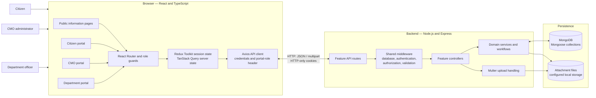
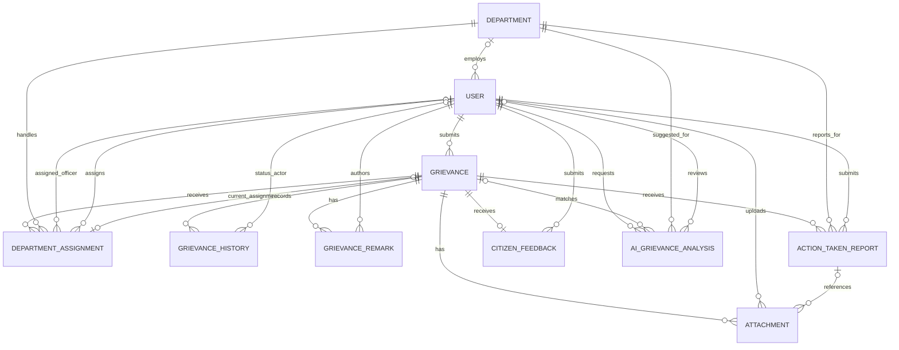
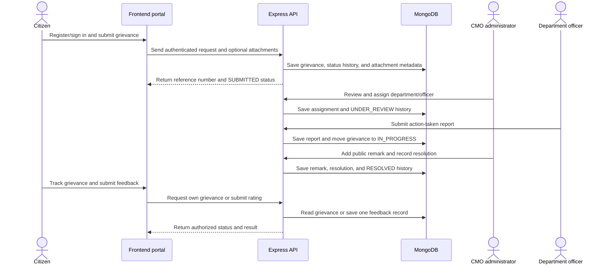

# System Architecture

## Overview

The CM Kerala Public Grievance Redressal Portal is a browser-based, three-tier application:

1. **Frontend:** A React single-page application that provides public pages and role-specific experiences for citizens, CMO administrators, and department officers.
2. **Backend:** An Express API that validates requests, authenticates users, enforces role and record access, applies grievance workflows, and coordinates persistence.
3. **Data and file storage:** MongoDB stores application records using Mongoose models. Uploaded file contents are stored on the backend's configured filesystem storage; MongoDB stores attachment metadata.

The frontend communicates with the API over HTTP using JSON for standard operations and multipart form data for file uploads. Authenticated browser requests include credentials and use role-specific HttpOnly cookies. Authorization is enforced by the backend; frontend route guards provide navigation and user experience, not a substitute for API security.

## System architecture diagram

The production hosting topology may place the frontend and backend on separate origins. In that case, the backend CORS allowlist, credentialed requests, HTTPS, and browser cookie settings must be configured consistently. See the [backend README](../backend/README.md#authentication-and-cors).

## Frontend

The frontend is a React 19 and TypeScript single-page application built and served during development by Vite. Its main architectural areas are:

- **Application shell and routing:** `frontend/src/main.tsx` mounts the app. `frontend/src/app/providers.tsx` installs Redux and TanStack Query providers and bootstraps the current session. `frontend/src/app/router.tsx` defines public and role-specific routes and lazy-loads page components.
- **Feature modules:** `frontend/src/features/` groups code by domain, including authentication, citizen, CMO, department, grievances, and contact. Feature components use shared layouts and controls from `frontend/src/shared/`.
- **Client state:** Redux Toolkit tracks client-side authentication/session state. TanStack Query manages server data and caching. React Hook Form and Zod support form handling and validation.
- **API client:** `frontend/src/lib/axios.ts` creates the shared Axios client, derives its base URL from `VITE_API_BASE_URL`, includes credentials, and adds an `X-Portal-Role` header based on the current portal route.
- **Access boundaries:** Protected routes direct unauthenticated users to the relevant login and prevent accounts with a different role from entering the wrong portal. The API independently checks authentication and authorization on every protected request.

## Backend

The backend is a Node.js application using native ES modules and Express 5. Its feature routes are mounted in `backend/src/app.js` under `/api`; liveness and readiness routes are available under `/health` and `/api/health`.

A typical API request follows this path:

1. Express applies CORS, JSON and form parsing, and cookie parsing.
2. Database-backed API routes establish or reuse a MongoDB connection.
3. Route middleware authenticates the request and checks the user's role where required.
4. Zod schemas validate request bodies, query parameters, route parameters, and uploaded files.
5. A controller invokes the appropriate module service.
6. Services apply workflow and access rules and read or update Mongoose models.
7. The API returns a JSON response or, for attachment downloads, a file stream. Central error handling returns a consistent error response.

The backend uses HttpOnly cookies for role-specific access tokens. Passwords are hashed using bcrypt. Route access and grievance ownership/department membership are validated on the server.

### Backend modules

| Module | Responsibility |
|---|---|
| `auth` and `users` | Citizen registration, sign-in, session identity, and CMO-managed officer creation. Authentication uses the `User` model; it does not have a separate account collection. |
| `grievances` | Citizen submissions, reference numbers, scoped grievance lists and details, status changes, escalation, and resolution. |
| `departments` | Department listing and CMO department/officer administration. |
| `department-assignments` | Department/officer assignment, current assignment, and assignment history. |
| `grievance-history` | Grievance status history. |
| `grievance-remarks` | Public or internal grievance remarks. |
| `action-taken-reports` | Department officer reports and their attachment references. |
| `attachments` | Upload metadata, access checks, supplemental uploads, and authenticated downloads. |
| `citizen-feedback` | One citizen rating and optional comment per resolved grievance. |
| `ai-analysis` | Gemini decision-support analysis, duplicate candidates, and citizen review decisions; provides a CMO-only lookup for matching grievance analyses. |
| `contact-enquiries` | Public enquiry creation and CMO review/closure. |
| `dashboard` | CMO-wide and department-scoped grievance statistics. |
| `health` | Liveness and MongoDB readiness endpoints. |

## Database and persistence

MongoDB is accessed through Mongoose. Each model corresponds to a collection, and relationships are represented by ObjectId references. These references are application-level links, not SQL foreign keys; services and authorization middleware are responsible for checking that referenced data exists and is accessible.

The core collections are:

- `users` — citizens, CMO administrators, and department officers.
- `departments` — department records.
- `grievances` — grievance details and a reference to the current assignment.
- `departmentassignments` — assignment records, including earlier assignments.
- `grievancehistories` and `grievanceremarks` — status events and communications.
- `actiontakenreports` — reports submitted by department officers.
- `attachments` — metadata and grievance associations for uploaded files.
- `citizenfeedbacks` — post-resolution citizen feedback.
- `aigrievanceanalyses` — AI-generated summaries and recommendations, matched to a grievance by citizen, district, and description hash when an explicit grievance reference is not present.
- `contactenquiries` — standalone contact form submissions.

Uploaded file contents are separate from MongoDB records. The `attachments` collection stores filenames and file metadata, while the actual files are stored in the configured upload directory. Local development uses `backend/uploads/` by default. Serverless temporary storage is not durable or shared between instances; production deployments requiring reliable attachments should use persistent object storage.

### Entity relationship diagram

`||` denotes exactly one, `o|` zero or one, and `o{` zero or many. `CONTACT_ENQUIRY` is standalone and has no modeled references to the other collections. See [Database Design](03_Database_Design.md) for field definitions, constraints, and indexes.

## Grievance workflow

The implemented grievance statuses are `SUBMITTED`, `UNDER_REVIEW`, `IN_PROGRESS`, `RESOLVED`, and `REJECTED`. A department assignment moves a submitted grievance to `UNDER_REVIEW`; the first action-taken report moves it to `IN_PROGRESS`. CMO resolution requires the grievance to be in progress and a public CMO remark to exist. Citizens may submit feedback after resolution and only once per grievance.

## Related documentation

- [Project Overview](01_Project_Overview.md)
- [Database Design](03_Database_Design.md)
- [API Documentation](04_API_Documentation.md)
- [Setup and Testing](06_Setup_and_Testing.md)
- [User Guide](07_User_Guide.md)