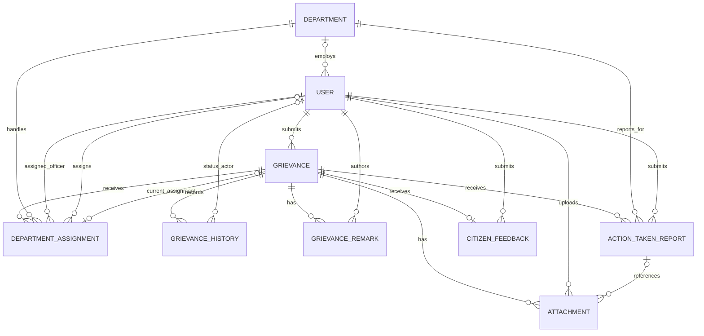

# Database Design

## Overview

The backend uses MongoDB through Mongoose ODM. Each entity below is a Mongoose model stored as a MongoDB collection; references are MongoDB `ObjectId` values declared with Mongoose `ref` fields. They are application-level references, not relational database foreign keys. Unless otherwise noted, models use Mongoose timestamps, which add `createdAt` and `updatedAt`.

The `auth.model.js` module re-exports the `User` model; it does not define a separate authentication collection. The collections listed here reflect the models in `backend/src/modules`.

## Entities and collections

### User (`users`)

| Field | Type | Constraints / purpose |
|---|---|---|
| `fullName` | String | Required; trimmed; max 120 characters |
| `email` | String | Required, unique, lowercased, trimmed; max 254 characters |
| `mobile` | String | Defaults to empty string; trimmed; max 20 characters |
| `password` | String | Required; minimum 8 characters; excluded from query results by default and hashed before save |
| `role` | String | Required; one of `citizen`, `cmo`, `department_officer`; defaults to `citizen` |
| `department` | ObjectId → `Department` | Optional; defaults to `null` |
| `isActive` | Boolean | Defaults to `true` |

### Department (`departments`)

| Field | Type | Constraints / purpose |
|---|---|---|
| `name` | String | Required, unique, trimmed |
| `slug` | String | Required, unique, lowercased, trimmed |
| `description` | String | Required, trimmed; max 500 characters |
| `isActive` | Boolean | Defaults to `true` |

### Grievance (`grievances`)

| Field | Type | Constraints / purpose |
|---|---|---|
| `referenceNumber` | String | Required, unique, indexed |
| `citizen` | ObjectId → `User` | Required, indexed; submitting citizen |
| `district` | String | Required; one of Kerala's 14 districts |
| `category` | String | Required; one of `Infrastructure`, `Health`, `Education`, `Public Services`, `Water & Sanitation`, `Transport`, `Other` |
| `subject` | String | Required, trimmed; max 200 characters |
| `description` | String | Required, trimmed; max 10,000 characters |
| `status` | String | One of `SUBMITTED`, `UNDER_REVIEW`, `IN_PROGRESS`, `RESOLVED`, `REJECTED`; defaults to `SUBMITTED`; indexed |
| `priority` | String | One of `Low`, `Medium`, `High`; defaults to `Medium`; indexed |
| `assignment` | ObjectId → `DepartmentAssignment` | Optional current assignment; defaults to `null`; indexed |
| `resolution` | String | Defaults to empty string; max 5,000 characters |
| `dueAt` | Date | Defaults to 15 days after creation; indexed |
| `escalatedAt` | Date | Optional; defaults to `null` |

### DepartmentAssignment (`departmentassignments`)

| Field | Type | Constraints / purpose |
|---|---|---|
| `grievance` | ObjectId → `Grievance` | Required, indexed |
| `department` | ObjectId → `Department` | Required, indexed |
| `officer` | ObjectId → `User` | Optional assigned department officer; defaults to `null` |
| `assignedBy` | ObjectId → `User` | Optional assigning user; defaults to `null` |
| `dueAt` | Date | Optional; defaults to `null` |

Assignments are separate records so assignment changes can be retained. The grievance's `assignment` field points to its current assignment record.

### GrievanceHistory (`grievancehistories`)

| Field | Type | Constraints / purpose |
|---|---|---|
| `grievance` | ObjectId → `Grievance` | Required, indexed |
| `status` | String | Required; uses the grievance status values |
| `assignedBy` | ObjectId → `User` | Optional user associated with the status change; defaults to `null` |

### GrievanceRemark (`grievanceremarks`)

| Field | Type | Constraints / purpose |
|---|---|---|
| `grievance` | ObjectId → `Grievance` | Required, indexed |
| `content` | String | Required, trimmed; max 2,000 characters |
| `createdBy` | ObjectId → `User` | Required author |
| `authorRole` | String | Required; `cmo` or `department_officer` |
| `visibility` | String | Required; `public` or `internal`; defaults to `public` |

### ActionTakenReport (`actiontakenreports`)

| Field | Type | Constraints / purpose |
|---|---|---|
| `grievance` | ObjectId → `Grievance` | Required, indexed |
| `departmentId` | ObjectId → `Department` | Required, indexed |
| `details` | String | Required, trimmed; max 5,000 characters |
| `attachments` | Array of ObjectId → `Attachment` | Optional references to report attachments |
| `submittedBy` | ObjectId → `User` | Required submitting officer |
| `reviewedAt` | Date | Optional review time; defaults to `null` |

### Attachment (`attachments`)

| Field | Type | Constraints / purpose |
|---|---|---|
| `grievance` | ObjectId → `Grievance` | Required, indexed |
| `uploadedBy` | ObjectId → `User` | Required uploader |
| `purpose` | String | Required; `grievance`, `action_report`, or `supplemental` |
| `filename` | String | Required, unique; stored file identifier |
| `originalName` | String | Required original file name |
| `mimeType` | String | Required media type |
| `size` | Number | Required file size |

Attachment documents store file metadata and associate each file with a grievance. Action reports reference their attachments by ObjectId.

### CitizenFeedback (`citizenfeedbacks`)

| Field | Type | Constraints / purpose |
|---|---|---|
| `grievance` | ObjectId → `Grievance` | Required, unique, indexed; limits feedback to one record per grievance |
| `citizen` | ObjectId → `User` | Required, indexed |
| `rating` | Number | Required; minimum 1, maximum 5 |
| `comment` | String | Defaults to empty string; trimmed; max 2,000 characters |

### ContactEnquiry (`contactenquiries`)

| Field | Type | Constraints / purpose |
|---|---|---|
| `name` | String | Required, trimmed; max 120 characters |
| `email` | String | Required, lowercased, trimmed; max 254 characters |
| `subject` | String | Required, trimmed; max 200 characters |
| `message` | String | Required, trimmed; max 5,000 characters |
| `status` | String | One of `new`, `reviewed`, `closed`; defaults to `new` |

## Relationships

In this diagram, `||` means exactly one, `o|` means zero or one, and `o{` means zero or many. Relationships are based on the models' ObjectId references; MongoDB does not enforce referential integrity automatically.

## Indexes and constraints

- Unique: `User.email`, `Department.name`, `Department.slug`, `Grievance.referenceNumber`, `Attachment.filename`, and `CitizenFeedback.grievance`.
- Grievance query indexes: `citizen`, `status`, `priority`, `assignment`, `dueAt`, and the compound index `{ district, category, status, priority }`.
- Assignment indexes: `grievance`, `department`, and the compound index `{ department, createdAt }`.
- History and remark indexes: `grievance`, plus `{ grievance, createdAt }` for chronological retrieval.
- Attachment indexes: `grievance`, plus `{ grievance, purpose }`.
- Action report indexes: `grievance` and `departmentId`.

Mongoose creates indexes from schema declarations. Application behavior and authorization must still validate references and access; an ObjectId reference alone does not ensure the referenced document exists or that the current user may access it.