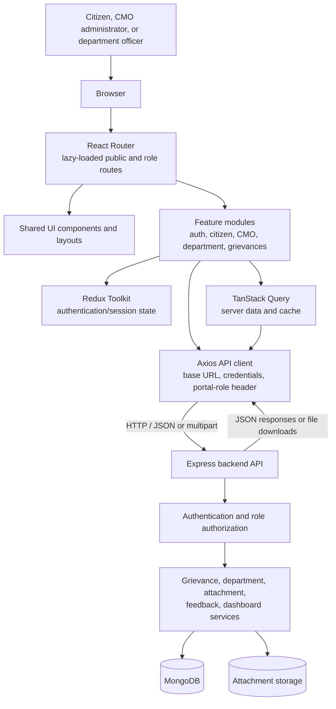
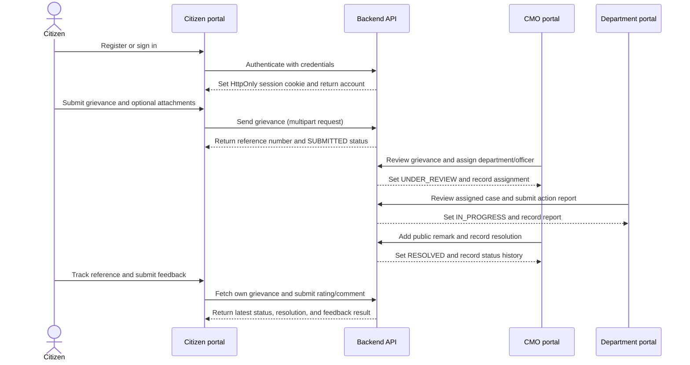

# CM Kerala Public Grievance Redressal Portal — Frontend

## Project overview

This project is the browser-based frontend for the CM Kerala Public Grievance Redressal Portal. It provides public information pages and separate workspaces for citizens, Chief Minister's Office (CMO) administrators, and department officers. The frontend communicates with the backend API for authentication, grievances, assignments, action reports, attachments, feedback, and dashboards.

## Features

- Public home, about, departments, how-it-works, FAQ, and contact pages.
- Citizen account registration and sign-in.
- Citizen dashboard, grievance submission with optional evidence files, reference-number tracking, and post-resolution feedback.
- CMO dashboard, grievance filtering and review, department/officer assignment, escalation, public remarks, and resolution.
- CMO administration for creating department officers, managing departments, and handling contact enquiries.
- Department officer dashboard, assigned grievance details, action-taken reports, and attachment handling.
- Role-protected pages and role-specific session handling using backend-managed HttpOnly cookies.
- Responsive layouts, form validation, and API error notifications.

## Tech stack

- **UI:** React 19 and React DOM
- **Language:** TypeScript
- **Build and development server:** Vite
- **Navigation:** React Router
- **Server state and caching:** TanStack Query
- **Client authentication state:** Redux Toolkit and React Redux
- **Forms and validation:** React Hook Form, Zod, and `@hookform/resolvers`
- **HTTP client:** Axios
- **Styling:** Tailwind CSS 4 with the Vite plugin
- **Charts:** Recharts, Chart.js, and `react-chartjs-2`
- **Notifications and icons:** Sonner and React Icons
- **Linting:** Oxlint

## Set up and run locally

### Prerequisites

- Node.js and npm.
- The backend running locally and connected to MongoDB. Follow the [backend setup guide](../backend/README.md) first.

### Install dependencies

From the repository root, open a terminal and run:

```powershell
cd frontend
npm ci
```

### Configure the environment

Create `frontend/.env` from the example:

```powershell
Copy-Item .env.example .env
```

Set the backend URL in `.env`:

```dotenv
VITE_API_BASE_URL=http://localhost:8080/api
```

| Variable | Required | Description |
|---|---|---|
| `VITE_API_BASE_URL` | No | Backend origin or API URL. The checked-in example uses `http://localhost:8080/api`. If omitted, the frontend defaults to `http://localhost:8080`. The frontend appends `/api` if the configured URL does not already end with it. |

Only put public configuration in `VITE_` variables: Vite bundles these values into browser assets. Never store passwords, database credentials, signing keys, or other secrets in the frontend environment file.

### Start the development server

With the backend running, start the frontend from `frontend/`:

```powershell
npm run dev
```

Open the local address printed by Vite (by default, `http://localhost:5173`). The backend must allow the frontend's origin and credentialed requests so browser authentication cookies work. See the [backend README](../backend/README.md#authentication-and-cors) for the current CORS configuration note.

### Available commands

Run these from `frontend/`:

| Command | Purpose |
|---|---|
| `npm run dev` | Start the Vite development server. |
| `npm run build` | Run TypeScript project checks and create a production build in `dist/`. |
| `npm run lint` | Run Oxlint. |
| `npm run preview` | Preview the production build locally after building. |

## Architecture

The frontend is organized as a single-page application. `src/main.tsx` mounts the app and its providers. The app layer sets up shared Redux and TanStack Query providers, checks the existing session, and configures routes. Public pages and role-specific feature pages are loaded through React Router's lazy route imports.

Feature code is grouped by domain under `src/features/` (auth, citizen, CMO, department, grievances, and contact). Page components use shared UI components and domain services. Services call the shared Axios client in `src/lib/axios.ts`; that client uses `VITE_API_BASE_URL`, includes credentials for cookie-based sessions, and sends the portal role header. Protected route components use the frontend's authentication state to direct signed-out users to the appropriate login and prevent the wrong role from entering a portal. The backend remains responsible for authenticating requests and authorizing access to records.

### Architecture diagram



## Workflows

### Citizen grievance workflow



### Workflow summary

1. A citizen registers or signs in, submits an issue, and receives a reference number. Supporting files are optional.
2. The CMO reviews submitted grievances, assigns a department and optionally an officer, and may set priority and a due date.
3. The assigned department officer investigates and submits an action-taken report, optionally with files.
4. The CMO reviews the reported action, adds a public remark, and records the resolution.
5. The citizen can track progress and submit one feedback rating after resolution.

The application currently exposes grievance statuses `SUBMITTED`, `UNDER_REVIEW`, `IN_PROGRESS`, `RESOLVED`, and `REJECTED`. Available actions depend on the grievance's state and the signed-in user's role.

## API reference

For endpoint methods, parameters, access roles, and request/response examples, see the [API Documentation](../documentation/04_API_Documentation.md). For user-facing role instructions, see the [User Guide](../documentation/07_User_Guide.md).

## Production configuration

Set `VITE_API_BASE_URL` in the frontend deployment environment to the deployed backend origin or its `/api` URL before building. Configure the backend to allow the exact frontend origin and credentialed requests. Because authentication uses HttpOnly cookies, production deployments across origins require compatible HTTPS, CORS, and browser cookie settings. See the [backend README](../backend/README.md#authentication-and-cors).
